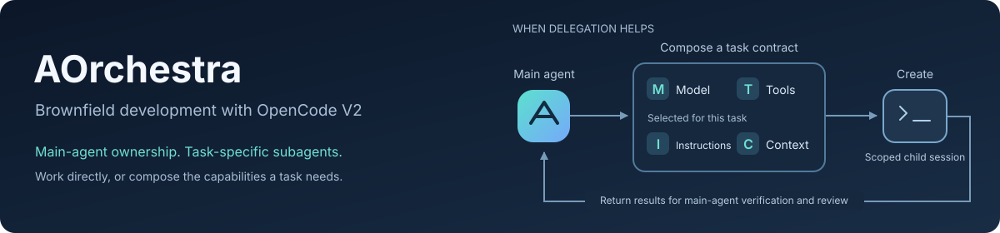
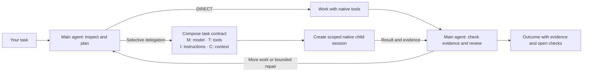

# AOrchestra for OpenCode V2



[](https://www.npmjs.com/package/aorchestra-opencode-v2)
[](https://github.com/p-sternik/AOrchestra-opencode/actions/workflows/release.yml)

**An OpenCode harness for changing existing codebases while preserving their contracts.**
One main agent owns your task, follows existing patterns and works directly or
delegates bounded work when useful. Start with [global setup](#quick-start); no
repository clone is required.

## The problem

In unfamiliar, brownfield and legacy repositories, a small change can affect
hidden callers, undocumented conventions and old compatibility requirements.
Coding agents need to find the relevant implementation, limit the patch and check
both the requested behavior and what must stay unchanged.

## Why AOrchestra

Native OpenCode provides agents, tools, sessions, permissions and storage.
AOrchestra adds a brownfield workflow on those primitives:

- **Follow existing code:** instructions favor nearby implementations and tests,
  focused changes and reuse over new abstractions.
- **Track acceptance:** scoped tasks record compatibility constraints, dependencies,
  fresh check evidence and bounded repair attempts.
- **Create task-specific subagents:** compose **model, tools, instructions and
  context (M · T · I · C)** for a fresh, scoped native session when delegation helps.
- **Build context and review evidence:** explicitly request a repository map or
  analyze local execution reports with bundled skills.

Use it for bug fixes, changes across modules and repository onboarding. Delegation
is optional; lower cost, higher quality and improved reliability are **not established**.

## Quick Start

### 1. Check the prerequisites

Install **OpenCode V2**, **Bun** (tested with 1.2.15), **Node.js 22+ / npm** and **Git**.
Authenticate your intended provider in OpenCode before setup.

```sh
opencode2 --version
bun --version
node --version
npm --version
git --version
```

Setup accepts stable OpenCode **>=2.0.26 <3.0.0**; native smoke checks passed on
**2.0.26 and 2.0.27**, with API packages pinned to 2.0.26. Other accepted versions
still need integration checking. Older runtimes, prereleases and V3 are rejected.
See [runtime compatibility](VALIDATION.md#runtime-version-compatibility).

This guide uses `opencode2`. If your V2 executable is named `opencode`, use that
name in runtime commands and set `export OPENCODE_BIN=opencode` in a Unix shell
or `$env:OPENCODE_BIN = 'opencode'` in PowerShell before setup and checks.
Python is optional, used only by the repository-map helper.

### 2. Run setup

```sh
npx --ignore-scripts --yes --package=aorchestra-opencode-v2@latest aorchestra setup
```

> **Published-package issue:** 0.8.0–0.8.1 omit a smoke-checker helper, so setup/check
> can fail with `Cannot find module './eval-usage'` after saving configuration.
> This branch fixes packaging; use a release containing the fix before expecting
> setup verification to pass. See [installation diagnostics](docs/reference.md#global-installation).

Setup installs the plugin through native OpenCode and merges **agents,
instructions, permissions and models** into your active global JSON/JSONC config.
It preserves comments, unrelated agents, providers, plugins and settings, and
backs up changed configuration. Project-local config and instructions stay intact.
Setup reuses an available configured main model or asks you to choose one.

It then checks global loading with an isolated database and **zero model calls**.
That check does not prove successful provider inference. The CLI installs its own
exact published version; `@latest` does not install unreleased main changes.

> `opencode2 plugin add aorchestra-opencode-v2@latest` (or `opencode plugin add`)
> only registers the plugin. It does **not** complete AOrchestra setup. If you
> already ran it, run the setup command above to finish configuration.

**Coming from main:** first-launch setup completes a native `plugin add`
registration when you next open OpenCode. It reuses an available configured model
or shows a model picker, preserves unrelated settings, backs up changes and runs
the no-inference check. Restart when prompted. This flow is **not in npm 0.8.1**;
until a release includes it, use the setup command above. See
[first-launch setup](docs/reference.md#first-launch-setup).

### 3. Run your first task

From your project's directory:

```sh
opencode2 run --standalone --agent aorchestra 'Fix the missing-user error. Preserve the public API and add a regression test.'
```

No project config is required. Project-local settings can override global setup.
Harness tools and task-state injection are active only when AOrchestra is selected;
a globally loaded plugin can still appear in logs when another agent runs.

## Common workflows

Give AOrchestra a concrete outcome and the behavior to preserve:

**Fix a bug:** use the first-task command above, naming the failing behavior,
public contract and regression test you need.

**Change multiple modules:**

```text
Add an optional timeout to the API client and update its callers across modules.
Keep existing call signatures working. Find affected consumers and run their checks.
```

**Map an unfamiliar repository:**

```text
Use aorchestra-repo-context to map this repository's entrypoints, modules and tests.
Update AGENTS.md with concise navigation, preserving its existing rules. Write in English.
```

**Review execution evidence:** first [generate a report](#updates-and-troubleshooting),
then ask:

```text
Use aorchestra-improve to analyze /path/to/report.md. Identify up to three
evidence-backed bottlenecks, propose the smallest changes and define validation
criteria. Do not modify the harness or run paid experiments.
```

Both skills are invoked explicitly. Mapping reuses existing documentation;
improvement review separates observations from hypotheses and can report
insufficient data. Report generation makes no model calls; skill interpretation
runs in your model-backed agent session.

## How it works



For each delegated task, the main agent selects a configured model tier and allowed
tools, supplies the task instruction and relevant context, and creates a fresh child
session. Context includes a bounded source handoff with facts, unknowns and checks;
the contract also records exact edit paths and verification requirements.

Each child uses a shared executor template specialized by its task contract. The
main agent owns the result, runs verification and reviews compatibility. Tracked work supports dependencies, persistent phases and bounded
repair; worker completion alone does not accept a task.

- **Runtime completion:** execution finished; correctness is still unknown.
- **Tracked acceptance:** fresh verifier evidence, scope checks and an explicit
  compatibility review satisfy the registered task contract.
- **Independently verified correctness:** separate behavioral and regression
  checks test the result; their coverage still limits what they establish.

DIRECT work can be untracked and has no automatic semantic acceptance claim.
See [contracts and verification](docs/reference.md#task-contracts-and-verification).

## Configuration

For non-interactive setup, supply an available model identifier:

```sh
npx --ignore-scripts --yes --package=aorchestra-opencode-v2@latest aorchestra setup --model=provider/model
```

Replace `provider/model` with an identifier from your authenticated provider's
OpenCode catalogue. Existing available tier choices are retained; fresh setup uses
one model for all tiers. Optional `--fast=...`, `--balanced=...` and `--strong=...`
select worker models. Add `--default` to replace an existing default agent.

Default permissions allow routine test/typecheck/lint scripts and Git inspection;
other shell commands ask, and Git push is denied. Customized permission rules are
preserved. These allowances trust repository scripts to execute code: **native
permissions are not an OS sandbox**.

Plugin options include budgets, project checks, `telemetry: false`,
`autoSetup: false` (disable main's first-launch configuration),
`autoUpdate: false` (notifications only) and `updateCheck: false` (disable updates
and checks). Merge options into the existing registration; see the
[technical reference](docs/reference.md) and [manual setup guide](docs/setup-for-agents.md#manual-fallback).

## Updates and troubleshooting

Rerun the Quick Start setup command to update to the latest published release,
then restart OpenCode. Inspect the registry version and check a target project:

```sh
npm view aorchestra-opencode-v2 version
npx --ignore-scripts --yes --package=aorchestra-opencode-v2@latest aorchestra check --project=/absolute/path/to/project
npx --ignore-scripts --yes --package=aorchestra-opencode-v2@latest aorchestra report --project=/absolute/path/to/project --output=/path/to/report.md
```

Use your real project/output paths. Reports must read the same project and native
database as the execution; see [report options](docs/reference.md#metrics-and-improvement-reports).

Published **0.8.1** includes the setup flow, both skills, reports, managed stable
automatic updates, recurring checks and sidebar update-failure status. Main adds
first-launch setup and `/aorchestra-setup` to retry model selection after provider
authentication.
These main-only changes reach npm users after publication. Major upgrades and
Git/source installations require manual setup; see [update details](docs/reference.md#automatic-updates).

If setup fails, inspect its diagnostic and printed config/backup paths. Explicit
`OPENCODE_CONFIG` / `OPENCODE_CONFIG_CONTENT` overrides or project config can change
what loads. Conflicting global JSON/JSONC registrations need reconciliation.
A failed post-install check can leave the backed-up change saved; no automatic
rollback occurs. To undo setup, restore only AOrchestra-related entries from the
backup while preserving subsequent unrelated edits.

<details>
<summary>Development channel: GitHub main</summary>

For explicitly requested unreleased changes:

```sh
npx --allow-git=all --ignore-scripts --yes --package=git+https://github.com/p-sternik/AOrchestra-opencode.git#main aorchestra setup --channel=main
```

Setup pins an exact commit. `--allow-git=all` is a per-command npm 12 allowance;
older npm may warn. CLI `--channel` and `--package` options are mutually exclusive.

</details>

## Evidence and limitations

[Validation](VALIDATION.md) records deterministic tests, packaging checks and
no-inference native integration checks. They validate workflow mechanics,
loading, permissions and telemetry; they do not establish effectiveness on real
legacy repositories, cost savings or improved reliability. Prompt instructions
are not behavioral guarantees, and missing usage remains unknown rather than zero.

Selective delegation may add overhead. Large repositories need care with snapshot
limits and exclusions. Failed edits are not automatically rolled back, and parallel
writers are not isolated. Read the [technical limits](docs/reference.md#limits)
and [benchmark methodology](docs/benchmark.md) before interpreting results.
Model-backed evaluation is opt-in and can incur provider costs.

Inspired by **AOrchestra: Automating Sub-Agent Creation for Agentic Orchestration**,
Jianhao Ruan et al. (2026): [paper](https://arxiv.org/abs/2602.03786v2) ·
[original implementation](https://github.com/FoundationAgents/AOrchestra).
This is an independent adaptation, unaffiliated with the authors. Their published
benchmark results describe the original system. See [research sources](RESEARCH.md).

## Documentation

- [Setup for coding agents and manual fallback](docs/setup-for-agents.md)
- [Technical reference: configuration, verification, reports and limits](docs/reference.md)
- [Validation results and remaining gaps](VALIDATION.md)
- [Benchmark methodology](docs/benchmark.md)
- [Development, packaging and releases](CONTRIBUTING.md)
- [Changelog](CHANGELOG.md)

Maintained by [Piotr Sternik](https://github.com/p-sternik).
[Report an issue](https://github.com/p-sternik/AOrchestra-opencode/issues) with the
package version, OpenCode version, OS and a minimal reproduction.
