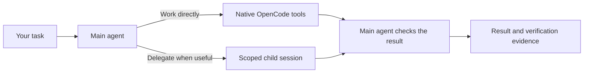

# AOrchestra for OpenCode V2

[](https://github.com/p-sternik/AOrchestra-opencode/actions/workflows/validate.yml)
[](https://github.com/p-sternik/AOrchestra-opencode/releases)
[](VALIDATION.md)

**Current release: 0.3.0** <!-- x-release-please-version -->

**An OpenCode harness for working on existing codebases.** One main agent owns the
task, works directly when it makes sense and delegates bounded work when useful.
It favors existing patterns, small patches and compatibility checks.

Inspired by [FoundationAgents/AOrchestra](https://github.com/FoundationAgents/AOrchestra),
adapted to native OpenCode V2 sessions, permissions and plugin storage.

## Why use it?

- Reuse existing implementations and tests before adding abstractions or rewrites.
- Delegate selectively with relevant context and a clear change scope.
- Select project checks for affected files and require fresh native evidence.
- Resume tracked workflow state with bounded repair cycles after failed checks.
- Review local execution metrics without an extra model call after every task.

> **Status:** early-stage, tested with OpenCode **2.0.26**. Mechanism tests pass;
> representative real-model brownfield effectiveness and cost remain unmeasured.
> See [validation results](VALIDATION.md). The installable package is currently
> distributed from GitHub main; the original 0.2.2 release predates this installer.

When any other agent is selected, harness tools and task-state
injection are inactive. A globally installed plugin still appears in OpenCode's
discovery/loading logs; that does not mean AOrchestra is executing the task.
The internal executor requires an active contract owned by the AOrchestra agent.

## Install globally

### 1. Check the prerequisites

Install **OpenCode V2 2.0.26**, **Bun** (tested with 1.2.15), **Node.js 22+ / npm**
and **Git**. Authenticate your intended provider in OpenCode. Python is optional,
needed only for the repository-context helper and its development tests.

```sh
opencode2 --version
bun --version
```

This guide uses `opencode2`. If your V2 executable is named `opencode`, set
`OPENCODE_BIN=opencode` before running the installer. In PowerShell use
`$env:OPENCODE_BIN = 'opencode'`; in a Unix shell use `export OPENCODE_BIN=opencode`.

### 2. Run setup

```sh
npx --allow-git=all --ignore-scripts --yes --package=git+https://github.com/p-sternik/AOrchestra-opencode.git#main aorchestra setup
```

No manual copying or cloning is needed. Setup:

- Finds the active global config, including `OPENCODE_CONFIG_DIR` overrides.
- Reuses an available configured main model or asks you to choose one.
- Installs the plugin through OpenCode's native `plugin add` command.
- Merges the agents and options into global JSON/JSONC, preserving comments,
  providers, unrelated plugins and existing settings. Changed files get a backup.
- Checks actual global loading with an isolated database and zero model calls.

Model discovery uses the normal OpenCode database so existing provider sign-ins
remain available; it queries the catalogue without running a task. The smoke
check uses a separate test database.

The GitHub default resolves main to an exact commit before registering the plugin.
The command explicitly permits Git fetching for this invocation, as required by
[npm 12](https://docs.npmjs.com/cli/v12/using-npm/config/#allow-git), and disables
install lifecycle scripts. It does not change your global npm settings. Older npm
versions may warn about the newer allow-git option; omit it if their CLI requires that.

The selected source/config/backup paths are printed. Agent instructions come from
that installed package and are stored in the global config; no checkout paths
are required. The skill stays bundled with the plugin.

For non-interactive setup, provide an available model explicitly:

```sh
npx --allow-git=all --ignore-scripts --yes --package=git+https://github.com/p-sternik/AOrchestra-opencode.git#main aorchestra setup --model=provider/model
```

Replace `provider/model` with an actual identifier. Existing available tier models
are retained; a fresh setup uses the main model for all tiers. Use `--fast=...`,
`--balanced=...` and `--strong=...` to select separate models. Add `--default` to
replace an existing default agent with AOrchestra.

If global JSON already registers AOrchestra and JSONC also exists, setup asks you
to move that registration into JSONC rather than modifying two files silently. Explicit config
overrides and project-local config can supersede global settings; setup reports
terminal overrides, and `check --project=...` tests a selected project location.

### 3. Use it in any project

Open a terminal in your project and run:

```sh
opencode2 run --standalone --agent aorchestra 'Fix the missing-user error. Keep the public API unchanged and add a regression test.'
```

No project config or `OPENCODE_CONFIG` assignment is required. OpenCode's native
permissions still apply, including requests to run shell commands. Catalogue
availability and installation checks do not establish successful provider inference.

## Check, update and report

```sh
npx --allow-git=all --ignore-scripts --yes --package=git+https://github.com/p-sternik/AOrchestra-opencode.git#main aorchestra check
npx --allow-git=all --ignore-scripts --yes --package=git+https://github.com/p-sternik/AOrchestra-opencode.git#main aorchestra check --project=/absolute/path/to/project
npx --allow-git=all --ignore-scripts --yes --package=git+https://github.com/p-sternik/AOrchestra-opencode.git#main aorchestra report --project=/absolute/path/to/project --output=/path/to/report.md
```

Run setup again to update to the latest GitHub commit. It replaces recognized
AOrchestra registrations, preserves existing budgets and model choices where
available, and avoids rewriting an unchanged config. For a specific published npm
version or Git revision, use `setup --package=<npm-or-git-spec>` with the matching
CLI version. The package name is `aorchestra-opencode-v2`; npm registry publication
is not yet available, so use the working GitHub command above.

Reports make no model calls or policy changes. Costs are estimates, and runtime
completion alone does not establish semantic correctness. To undo setup, use the
reported backup to restore AOrchestra-related changes while retaining subsequent
unrelated edits. Remove its plugin/agent entries before deleting installation data.

## Repository context

Request a map explicitly:

```sh
opencode2 run --standalone --agent aorchestra 'Use aorchestra-repo-context to map this repository and update AGENTS.md with concise navigation. Write the documentation in English.'
```

The bundled skill has the native ID `aorchestra-repo-context`, preventing a collision
with a separately installed `repo-context`. It reuses existing docs and preserves
authored AGENTS.md rules. Ordinary coding does not require a documentation phase.
Other agents retain normal skill discovery; AOrchestra's main agent permits only
its bundled skill by default.

## How it works



Each delegation gets task-specific instructions, context, tools and a model.
It also requires a bounded source handoff separating facts, candidates, unknowns
and checks. Fast research is limited to declared fact lookup; synthesis uses
balanced/strong. A reasoned fast-to-strong retry is available within the existing
two-attempt budget. See the [routing contract](docs/reference.md#task-contracts-and-verification).
Tracked tasks persist discovery, planning, execution, verification and bounded repair
phases. Verification selects configured path checks or existing package scripts,
then the primary runs them through native tools and permissions. Worker completion
is separate from tracked-task acceptance. Workers have scoped
tools/edit paths; the main agent runs tests. Permissions are not an OS sandbox.
Failed changes are not automatically rolled back. Large repositories need care
around snapshot limits and excluded paths; see the [technical reference](docs/reference.md).

## Set up with an AI agent

Give this prompt to a coding agent with access to your terminal and files:

```text
Install AOrchestra globally for OpenCode V2.
Read https://raw.githubusercontent.com/p-sternik/AOrchestra-opencode/main/docs/setup-for-agents.md
and follow the packaged setup procedure, preserving my existing configuration.
```

## Design sources and evidence

The original architectural source is **AOrchestra: Automating Sub-Agent Creation
for Agentic Orchestration**, Jianhao Ruan et al. (2026):
[paper, arXiv v2](https://arxiv.org/abs/2602.03786v2) ·
[reference implementation](https://github.com/FoundationAgents/AOrchestra).
Its instruction/context/tools/model abstraction informs our delegation. This is
an independent adaptation, unaffiliated with the original authors.

Source reviews of mini-SWE, SWE-agent, OpenHands and Aider informed simplicity,
recovery, verification and selective context. Published AOrchestra benchmark
results describe the original system, not this adaptation. Our three evaluation
fixtures are a smoke corpus; learned routing and fine-tuning are not implemented.
See [RESEARCH.md](RESEARCH.md) for pinned revisions and [VALIDATION.md](VALIDATION.md)
for observed checks and remaining gaps.

## Documentation and help

| Looking for | Read |
| --- | --- |
| Agent-assisted setup and manual fallback | [Setup guide](docs/setup-for-agents.md) |
| Architecture, configuration and limits | [Technical reference](docs/reference.md) |
| Test coverage | [Validation](VALIDATION.md) |
| Changes between releases | [Changelog](CHANGELOG.md) |
| Development, packaging and releases | [Contributing](CONTRIBUTING.md) |
| Automatic npm publication | [Publisher setup](docs/npm-publishing.md) |

Maintained by [Piotr Sternik](https://github.com/p-sternik). For bugs or questions,
[open an issue](https://github.com/p-sternik/AOrchestra-opencode/issues) with the
installed package spec/version, OpenCode version, OS and a minimal reproduction.
Release Please prepares version/changelog PRs; merging one publishes a Git tag
and GitHub Release. npm publication runs in the same workflow after the owner
configures Trusted Publishing and enables its repository variable.
