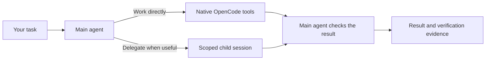

# AOrchestra for OpenCode V2

[](https://github.com/p-sternik/AOrchestra-opencode/actions/workflows/validate.yml)
[](https://github.com/p-sternik/AOrchestra-opencode/releases)
[](VALIDATION.md)

**An OpenCode harness for working on existing codebases.** One main agent owns the
task, works directly when it makes sense, and delegates bounded work when useful.
It favors existing patterns, small patches and compatibility checks.

Inspired by [FoundationAgents/AOrchestra](https://github.com/FoundationAgents/AOrchestra),
adapted to native OpenCode V2 sessions and permissions.

## Why use it?

- **Work with the code you already have.** Find existing implementations and tests
  before adding new abstractions or rewriting modules.
- **Delegate selectively.** Keep related diagnosis, editing and testing together;
  hand off work with a clear scope and relevant context.
- **Check the result.** Tracked changes require current verification evidence and
  a compatibility review before acceptance.
- **Learn from actual runs.** Local metrics and on-demand reports reveal recurring
  problems without an extra model call after every task.

> **Status:** early-stage, tested with OpenCode **2.0.26**. Mechanism tests and CI
> pass; effectiveness and cost on representative legacy tasks remain unmeasured.
> See [validation results](VALIDATION.md).

## How it works



Delegated work receives a task-specific instruction, context, tool set and model.
The main agent owns the outcome; tracked-task acceptance is separate from a
worker's completion report.

## Set up with an AI agent

Give the following prompt to your coding agent. It needs access to your terminal
and files to perform the setup; a chat-only assistant can explain the steps.

```text
Install AOrchestra globally for my OpenCode V2 setup.
Read https://raw.githubusercontent.com/p-sternik/AOrchestra-opencode/main/docs/setup-for-agents.md
and follow its setup procedure. Discover my active global OpenCode config and merge
AOrchestra into it, preserving my existing settings.
```

The [agent setup guide](docs/setup-for-agents.md) covers environment discovery,
model selection, a global configuration merge and a no-inference installation check. The
manual steps below remain available if you prefer to configure it yourself.

## Quick start

### 1. Check the prerequisites

You need **OpenCode V2 2.0.26**, **Bun 1.2.15**, **Git**, **Node.js/npm**, and an
authenticated model provider in OpenCode. CI uses Node.js 22.

This guide uses `opencode2` as the V2 command. If yours is named `opencode`, replace
`opencode2` below and set `OPENCODE_BIN=opencode` when using the supplied scripts.
Check that the command reports **2.0.26**:

```sh
opencode2 --version
bun --version
```

Python 3 is optional: only the repository-context helper and its development tests
need it. You can run the harness without Python.

### 2. Download the harness

```sh
git clone https://github.com/p-sternik/AOrchestra-opencode.git
cd AOrchestra-opencode
npm ci --ignore-scripts
```

This downloads current main, which includes the global-installation checker.
Until the next release, published `0.2.2` does not include that checker. Record
`git rev-parse HEAD` for reproducibility; once a release includes it, prefer its
tag. Cloning alone does not change your global OpenCode configuration. For a ZIP,
use **Code → Download ZIP** for main, extract it and run `npm ci --ignore-scripts`.
Published release archives are available under
[GitHub Releases](https://github.com/p-sternik/AOrchestra-opencode/releases).

### 3. Choose your models

Inspect the supplied `opencode.json` as a template. Choose models available
through your OpenCode provider, then apply them to the global config in step 4:

| Setting | Used for |
| --- | --- |
| `agents.aorchestra.model` in the global config | Main agent; the template currently uses top-level `model` |
| Plugin options → `models.fast` | Lightweight delegated work |
| Plugin options → `models.balanced` | General delegated work |
| Plugin options → `models.strong` | More demanding delegated work |

Use the `provider/model` identifiers shown by your OpenCode setup. The supplied
GitHub Copilot values are example defaults; their availability is not guaranteed.

### 4. Merge into your global OpenCode configuration

Discover the configuration directory used by your V2 executable:

```sh
opencode2 debug paths
```

Check `OPENCODE_CONFIG_DIR` too: it overrides the normal config directory in V2.
Open the existing `opencode.json` or `opencode.jsonc` there. If both exist, inspect
their precedence before editing; JSONC is loaded after JSON in 2.0.26. If neither
exists, create `opencode.json` in the discovered directory.

Merge the supplied template's AOrchestra plugin/options and two agent definitions
into that file. Keep your existing providers, other agents, plugins and settings.
Replace the template's relative paths with **absolute paths** to the permanent
harness installation:

| Field | Example Windows value |
| --- | --- |
| AOrchestra plugin `package` | `C:/tools/AOrchestra-opencode/plugins/aorchestra` |
| Main agent `system` | `{file:C:/tools/AOrchestra-opencode/instructions/aorchestra.md}` |
| Executor `system` | `{file:C:/tools/AOrchestra-opencode/instructions/aorchestra-executor.md}` |

Use your actual install path; on Linux/macOS use paths such as
`/home/you/tools/AOrchestra-opencode/plugins/aorchestra`. The plugin target must be
the directory, not the `.ts` file. Keep the installation at that location.

Apply your chosen models from step 3. Set the AOrchestra agent's `model` to your
main model so other agents can retain the existing top-level model. Set
`default_agent` to `aorchestra` if you want it selected by default. Preserve unrelated
permissions and tuning. The setup guide explains skill-discovery settings and
duplicate registrations; use it for agent-assisted merging.

### 5. Run a task in any project

With the global config installed, enter your project and run:

**Windows — PowerShell**

```powershell
Set-Location 'C:\projects\your-project'
opencode2 run --standalone --agent aorchestra 'Fix the failing test. Preserve existing behavior and verify the change.'
```

**Linux / macOS / WSL — shell**

```sh
cd /absolute/path/to/your-project
opencode2 run --standalone --agent aorchestra 'Fix the failing test. Preserve existing behavior and verify the change.'
```

No project config or per-terminal `OPENCODE_CONFIG` override is needed. If you
previously set a template override, remove it or restore its prior value. Existing
project-local config can override global settings. OpenCode's configured permissions
still apply, including requests to run shell commands.

**Installation check:** from a current main checkout, run
`bun run check -- --global` (set `OPENCODE_BIN` if your V2 binary is named `opencode`).
It checks global loading from a neutral location, uses an isolated test database
and makes no model calls. For a particular project, set `AORCHESTRA_CHECK_PROJECT`
to its absolute path. This mode is new on main; the original 0.2.2 checker only
validates its repository template and does not confirm your global installation.

## Everyday use

Describe the outcome you want. You do not need to manually create subagents or
task contracts:

```sh
opencode2 run --standalone --agent aorchestra 'Fix the missing-user error. Keep the public API unchanged and add a regression test.'
```

For an unfamiliar repository, explicitly request a context map:

```sh
opencode2 run --standalone --agent aorchestra 'Use repo-context to map this repository and update AGENTS.md with concise navigation. Write the documentation in English.'
```

The bundled skill reuses existing documentation and preserves authored AGENTS.md
rules. It runs on request; ordinary coding does not require a documentation phase.

To review execution metrics, return to the harness folder:

```sh
bun run report -- --project=/absolute/path/to/your-project --output=work/report.md
```

Reports make no model calls and do not change the harness policy. Costs are
estimates; runtime completion alone does not establish semantic correctness.

## Things to know

- Workers have scoped tools and edit paths. The main agent runs tests. Permissions
  are not an operating-system sandbox, and failed changes are not automatically reverted.
- Large repositories may need configuration: whole-tree snapshots have size limits
  and exclude some paths, including root `build` and `dist` directories.
- This profile enables only the bundled `repo-context` skill. Existing repository
  AGENTS.md instructions still apply.

See the [technical reference](docs/reference.md) for task contracts, budgets,
snapshot exclusions, telemetry and evaluation commands.

## Design sources and evidence

The original architectural source is **AOrchestra: Automating Sub-Agent Creation
for Agentic Orchestration**, by Jianhao Ruan et al. (2026):
[paper, arXiv v2](https://arxiv.org/abs/2602.03786v2) ·
[reference implementation](https://github.com/FoundationAgents/AOrchestra).
Its instruction/context/tools/model abstraction informs our dynamic delegation.
This repository is an independent OpenCode adaptation and is not affiliated with
the original authors.

| Basis | What it supports here |
| --- | --- |
| AOrchestra paper and pinned source review | Dynamic agent contracts; architectural inspiration |
| Reviews of mini-SWE, SWE-agent, OpenHands and Aider | Design choices around simplicity, recovery, verification and selective context |
| Local tests and Windows/Linux CI | 39 harness tests and 13 repository-context helper tests |
| Native OpenCode 2.0.26 smoke check | Plugin/session loading and controlled failure telemetry, with no model calls |

Published AOrchestra benchmark results describe the original system, not this
adaptation. Our three evaluation fixtures are a smoke corpus; representative
real-model brownfield effectiveness and cost have not yet been measured. We do
not implement the paper's learned routing or fine-tuning procedures.

Reviewed revisions and the reasoning behind each adaptation are recorded in
[RESEARCH.md](RESEARCH.md); test coverage and remaining gaps are in
[VALIDATION.md](VALIDATION.md). The release badge above links to the latest
published harness version; the OpenCode badge names the tested runtime version.

## Documentation and help

| Looking for | Read |
| --- | --- |
| Configuration by a coding agent | [Agent setup guide](docs/setup-for-agents.md) |
| Architecture, configuration and limits | [Technical reference](docs/reference.md) |
| What has been tested | [Validation](VALIDATION.md) |
| Research and design decisions | [Research](RESEARCH.md) |
| Changes between versions | [Changelog](CHANGELOG.md) |
| Development checks and automatic releases | [Contributing](CONTRIBUTING.md) |

Maintained by [Piotr Sternik](https://github.com/p-sternik). For bugs or questions,
[open an issue](https://github.com/p-sternik/AOrchestra-opencode/issues) with your
harness version, OpenCode version, operating system and a minimal reproduction.

Future versions are prepared automatically from Conventional Commits; merging the
release PR publishes the tag and GitHub Release. Use a release tag for reproducible
installation. This repository is installed from source and is not published to npm.
